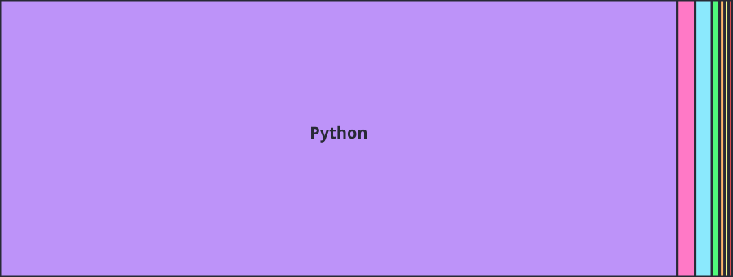
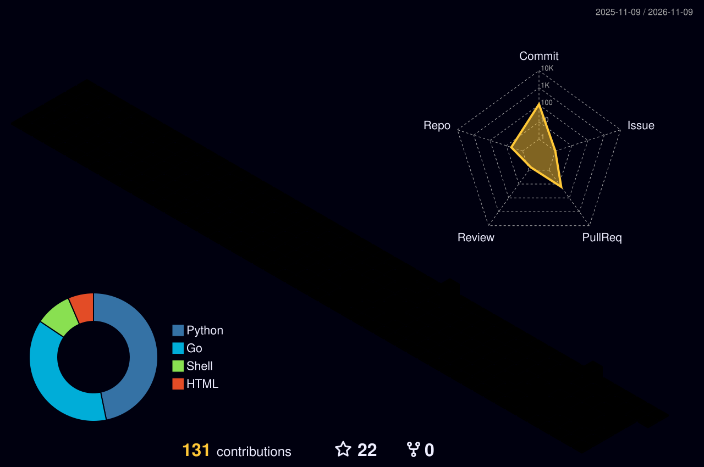

# Hey, I'm Erfan 👋

**Developer · Free software enthusiast · Occasional GitHub visitor**

> My name is Erfan. Although GitHub is not my primary platform since I'm a supporter of the Free Software Foundation, I occasionally create projects here for fun.

### 🦇 The Batcave — frames worth keeping

<table align="center">
  <tr>
    <td align="center" width="50%"><a href="https://tenor.com/view/saitama-one-punch-man-ok-okay-unimpressed-gif-4838585"><strong>One-Punch Man</strong> Saitama — OK 🎬</a></td>
    <td align="center" width="50%"><a href="https://tenor.com/view/arcane-enemy-jinx-short-gif-23598176"><strong>Arcane S1</strong> Enemy intro 🎬</a></td>
  </tr>
  <tr>
    <td align="center"><a href="https://tenor.com/view/batman-beyond-falseface-first-person-pov-fight-action-gif-25238730"><strong>Batman Beyond</strong> Red silhouette fight 🎬</a></td>
    <td align="center"><a href="https://tenor.com/view/gwen-stacy-gwen-spider-gwen-spider-woman-spider-man-gif-14013766178315762609"><strong>Across the Spider-Verse</strong> Gwen and her father 🎬</a></td>
  </tr>
  <tr>
    <td align="center"><a href="https://tenor.com/view/kohei-funny-grand-blue-anime-and-games-iori-gif-22375473"><strong>Grand Blue</strong> Kohei's speech 🎬</a></td>
    <td align="center"><a href="https://www.youtube.com/watch?v=RAVfp4YZ8nA"><strong>EPIC: The Musical</strong> Nya Tyan fan animatic 🎬</a></td>
  </tr>
</table>

## ⚡ Tech I work with

  
  
  
  
  
  
  

  
  
  
  
  
  
  
  
  

  
  
  
  
  
  
  
  
  

  
  
  
  
  
  

  
  
  
  
  
  
  
  
  

  
  
  
  
  
  
  
  
  
  

## 📊 GitHub, when I'm here

<!-- Generated by GitHub Actions; SVGs appear after successful workflow runs. -->

### Language treemap

### 3D contributions

### Contribution snake

Metrics are generated by GitHub Actions. The SVG appears after the first successful workflow run. Statistics reflect public GitHub activity, not all of my work elsewhere.

---

Built with caffeine, curiosity, and a healthy preference for free software. 🦇

